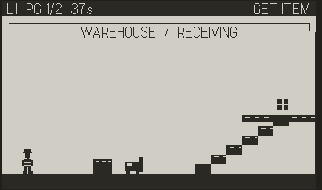

# Fulfillment Frenzy

A fast-paced warehouse platformer prototype for Playdate, built with Lua and the
Playdate SDK. Race through multi-screen warehouse shifts, climb shelves and raised
walkways, collect a parcel, deliver it to the shipping box, and turn the crank to
tape it shut before time runs out.



## How to play

- **Left / Right** — move through the warehouse
- **A** — jump onto stairs, shelves, and raised walkways
- **B** — pick up a parcel or place it in the shipping box when nearby
- **Crank** — tape the box shut when standing beside it

Each shift begins with a briefing card. Avoid moving forklifts and finish the
shipment before the timer expires; either a forklift collision or timeout fails
the shift. Press **A** to restart from its briefing.

## Warehouse shifts

There are three increasingly challenging layouts:

1. **Receiving** — two screens of racks and forklift traffic
2. **Aisle Jam** — two screens of blocked aisles and raised routes
3. **Outbound Dock** — a three-screen warehouse with more obstacles and faster
   forklifts

The camera scrolls horizontally as you move. The HUD shows the current shift,
screen, remaining time, and delivery objective. Shelves and raised floors can be
jumped through from below and landed on from above.

## Build and run

Requirements:

- Playdate SDK
- macOS and GNU Make (the run target opens Playdate Simulator)

The Makefile locates the SDK using `PLAYDATE_SDK_PATH`, or falls back to the
`SDKRoot` setting in `~/.Playdate/config`.

Build the game bundle:

```sh
make build
```

Build and open it in Playdate Simulator:

```sh
make run
```

The compiled bundle is `build/PlaydateStarter.pdx`. To remove it:

```sh
make clean
```

In VS Code, use **Terminal → Run Task** and select **Playdate: Build** or
**Playdate: Build and Run**.

## Project structure

- `Source/main.lua` — game states, camera, HUD, interactions, and level sprites
- `Source/player.lua` — worker sprite, movement, jumping, and collisions
- `Source/levels.lua` — shift layouts, platforms, stairs, and forklift paths
- `Source/pdxinfo` — Playdate game metadata
- `Makefile` — SDK-backed build, run, and clean commands
